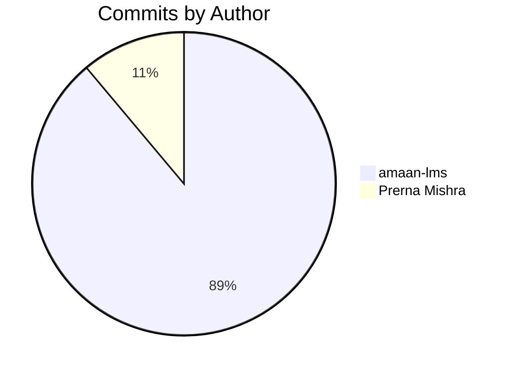

# JFKC Repository — Complete Commit History & Audit Report

**Repository URL**: `https://github.com/amaan-lms/JFKC.git`  
**Active Branch**: `main`  
**Date Range**: September 18, 2026 – October 27, 2026 (39 Days)  
**Total Commits on `main`**: 18  
**Total Authors**: 2  

---

## 1. Executive Summary

The **JFKC** repository is a React + Vite production web application built for JFKC (in collaboration with LMS Athena). The project has evolved across 18 commits over 39 days, encompassing frontend architecture, modular data schemas, responsive components, dynamic routing, integrated blogs, and SEO/analytics configurations.

### Key Metrics

| Metric | Value |
| :--- | :--- |
| **Total Commits (`main`)** | 18 |
| **Total Authors** | 2 (`amaan-lms`, `Prerna Mishra`) |
| **Total Lines Added** | +11,085 lines |
| **Total Lines Deleted** | -1,829 lines |
| **Net Code Growth** | +9,256 lines |
| **Active Development Span** | 39 days (2026-09-18 to 2026-10-27) |

---

## 2. Author Summary & Contribution Breakdown



### Author Comparison Table

| Contributor | Email | Commits | % Share | Additions | Deletions | Net Lines | Primary Responsibilities |
| :--- | :--- | :---: | :---: | :---: | :---: | :---: | :--- |
| **amaan-lms** | `amaan.javed@lmsathena.com` | **16** | 88.89% | +11,064 | -1,814 | +9,250 | Full-stack frontend architecture, UI components, routing, data catalogs (`services.js`, `blogs.js`, `industries.js`), page modules, assets, and sitemaps. |
| **Prerna Mishra** | `prerna.mishra@lmsathena.com` | **2** | 11.11% | +21 | -15 | +6 | Google Search Console verification meta tag configuration and token updates in `index.html`. |

---

## 3. Chronological Milestone Evolution

```mermaid
timeline
    title JFKC Development Timeline
    section Phase 1: Foundation
      2026-09-18 : Initial Vite & React scaffold
      2026-09-19 : Multi-page routing setup
      2026-09-21 : Core pages & legal sections
    section Phase 2: Catalogs & Polish
      2026-09-23 : Industry dynamic routing & data
      2026-09-25 : Navbar layout polishing
      2026-09-26 : Product & service page enhancements
      2026-09-26 : Dynamic ServiceDetail routing & data
      2026-09-28 : Contact form refactor
      2026-10-01 : UI/content overhaul & asset additions
      2026-10-09 : Product dashboard updates
    section Phase 3: SEO & Verification
      2026-10-16 : Google Search Console meta tag
      2026-10-19 : Blog system launch & first article
      2026-10-22 : Updated GSC verification token
      2026-10-23 : Hybrid model blog & XML Sitemap
    section Phase 4: Expansion & Tags
      2026-10-24 : Third blog post & sitemap update
      2026-10-27 : Tag / tracking script addition
```

---

## 4. Complete Commit-by-Commit Details

### Commit 1
* **Hash**: `80c9b1ba74fa8f5814afe0c7b2188196e2b300c1` (`80c9b1b`)
* **Author**: `amaan-lms` <`amaan.javed@lmsathena.com`>
* **Date**: `2026-09-18 10:33:31 +0530`
* **Subject**: `first commit`
* **Stats**: 31 files changed (+4,030 / -0 lines)
* **Changed Files**:
  * `.gitignore` (+24)
  * `.oxlintrc.json` (+8)
  * `README.md` (+19)
  * `index.html` (+16)
  * `package.json` (+29)
  * `package-lock.json` (+2353)
  * `public/logobg.png` (binary)
  * `src/App.css` (+184)
  * `src/App.jsx` (+29)
  * `src/main.jsx` (+10)
  * `src/index.css` (+289)
  * `vite.config.js` (+8)
  * Media assets: `bg.png`, `bg2.png`, `bg3.png`, `herobg2.png`, `heroimg.png`, `herovid1.mp4`, `herovid2.mp4`, `logo.jpeg`, `logobg.png`, `who_we_are.png`
  * Components: `CTA.jsx` (+59), `Footer.jsx` (+133), `Navbar.jsx` (+374)
  * Home sections: `About.jsx` (+101), `Hero.jsx` (+65), `SetUsApart.jsx` (+106), `VissionMission.jsx` (+91), `WhoWEAre.jsx` (+66), `WhyChooseUs.jsx` (+66)
* **Summary**: Initial project creation. Setup Vite + React application, core CSS design tokens, landing page sections, responsive navbar, footer, and media files.

---

### Commit 2
* **Hash**: `67778bbb6d0b28e99afd04644fd152b02b05819e` (`67778bb`)
* **Author**: `amaan-lms` <`amaan.javed@lmsathena.com`>
* **Date**: `2026-09-19 11:52:52 +0530`
* **Subject**: `new`
* **Stats**: 10 files changed (+931 / -54 lines)
* **Changed Files**:
  * `package-lock.json` (+58)
  * `package.json` (+1)
  * `src/App.jsx` (+17, -22)
  * `src/components/Footer.jsx` (+2, -3)
  * `src/components/Navbar.jsx` (+64, -28)
  * `src/index.css` (+74, -1)
  * `src/pages/Home.jsx` (+23)
  * `src/pages/Portfolio.jsx` (+227)
  * `src/pages/Products.jsx` (+211)
  * `src/pages/Services.jsx` (+254)
* **Summary**: Extracted home page into dedicated route and introduced core top-level pages: Portfolio, Products, and Services. Updated navbar links and styling.

---

### Commit 3
* **Hash**: `f311f8d8b8883507d8bf7a3f934f0cafa709d74b` (`f311f8d`)
* **Author**: `amaan-lms` <`amaan.javed@lmsathena.com`>
* **Date**: `2026-09-21 16:19:25 +0530`
* **Subject**: `complete`
* **Stats**: 18 files changed (+2,011 / -205 lines)
* **Changed Files**:
  * `src/App.jsx` (+18)
  * `src/components/CTA.jsx` (+74, -42)
  * `src/components/Footer.jsx` (+24, -16)
  * `src/components/Home/About.jsx` (+6, -19)
  * `src/components/Home/Hero.jsx` (+7, -6)
  * `src/components/Home/WhoWEAre.jsx` (+111, -44)
  * `src/components/Home/WhyChooseUs.jsx` (+4, -3)
  * `src/components/Navbar.jsx` (+121, -71)
  * `src/pages/About.jsx` (+247)
  * `src/pages/Career.jsx` (+144)
  * `src/pages/Contact.jsx` (+280)
  * `src/pages/ImmersiveLearning.jsx` (+196)
  * `src/pages/LearningTechnology.jsx` (+188)
  * `src/pages/Privacy.jsx` (+63)
  * `src/pages/Products.jsx` (+8, -4)
  * `src/pages/Terms.jsx` (+127)
  * `src/pages/TrainingDelivery.jsx` (+196)
  * `src/pages/TrainingModules.jsx` (+197)
* **Summary**: Site expansion adding specialized vertical service pages (`ImmersiveLearning`, `LearningTechnology`, `TrainingDelivery`, `TrainingModules`), company pages (`About`, `Career`, `Contact`), and legal pages (`Terms`, `Privacy`).

---

### Commit 4
* **Hash**: `823c8e0e27259a8b550fcf6d90a9d6df812b18da` (`823c8e0`)
* **Author**: `amaan-lms` <`amaan.javed@lmsathena.com`>
* **Date**: `2026-09-23 14:42:39 +0530`
* **Subject**: `new update`
* **Stats**: 12 files changed (+531 / -224 lines)
* **Changed Files**:
  * `src/App.jsx` (+2)
  * `src/components/Home/About.jsx` (+7, -15)
  * `src/components/Home/SetUsApart.jsx` (+73, -87)
  * `src/components/Home/VissionMission.jsx` (+30, -16)
  * `src/components/Home/WhoWEAre.jsx` (+35, -22)
  * `src/components/Navbar.jsx` (+5, -4)
  * `src/data/industries.js` (+96)
  * `src/index.css` (+79, -4)
  * `src/pages/About.jsx` (+3, -6)
  * `src/pages/IndustryDetail.jsx` (+176)
  * `src/pages/LearningTechnology.jsx` (+15, -2)
  * `src/pages/Portfolio.jsx` (+10, -68)
* **Summary**: Added dynamic data configuration for target industries (`src/data/industries.js`) and dynamic route component `IndustryDetail.jsx`. Refactored homepage presentation components.

---

### Commit 5
* **Hash**: `6f528bc3227478ee457da0c23b3001bf8227a843` (`6f528bc`)
* **Author**: `amaan-lms` <`amaan.javed@lmsathena.com`>
* **Date**: `2026-09-25 14:05:56 +0530`
* **Subject**: `nn`
* **Stats**: 1 file changed (+12 / -25 lines)
* **Changed Files**:
  * `src/components/Navbar.jsx` (+12, -25)
* **Summary**: Optimized navigation dropdown menus and mobile navigation drawer UX.

---

### Commit 6
* **Hash**: `30a46a26953a8eec2ae28ea26418c8f3f7173de4` (`30a46a2`)
* **Author**: `amaan-lms` <`amaan.javed@lmsathena.com`>
* **Date**: `2026-09-26 10:50:49 +0530`
* **Subject**: `service and product page`
* **Stats**: 4 files changed (+202 / -76 lines)
* **Changed Files**:
  * `src/components/CTA.jsx` (+2, -2)
  * `src/components/Footer.jsx` (+2, -2)
  * `src/pages/Products.jsx` (+94, -60)
  * `src/pages/Services.jsx` (+104, -12)
* **Summary**: Visual revamp and feature expansion for Products and Services pages.

---

### Commit 7
* **Hash**: `048cc9ab33576ea14afb6b8793af849c61785a0d` (`048cc9a`)
* **Author**: `amaan-lms` <`amaan.javed@lmsathena.com`>
* **Date**: `2026-09-26 11:27:22 +0530`
* **Subject**: `serivcce page`
* **Stats**: 5 files changed (+942 / -179 lines)
* **Changed Files**:
  * `src/App.jsx` (+2)
  * `src/components/Navbar.jsx` (+1)
  * `src/data/services.js` (+615)
  * `src/pages/ServiceDetail.jsx` (+302)
  * `src/pages/Services.jsx` (+22, -179)
* **Summary**: Modularized service catalog into `src/data/services.js` and added dynamic detail page `ServiceDetail.jsx`.

---

### Commit 8
* **Hash**: `fbf000c479a2236676ca8770098d138334f17767` (`fbf000c`)
* **Author**: `amaan-lms` <`amaan.javed@lmsathena.com`>
* **Date**: `2026-09-28 14:08:43 +0530`
* **Subject**: `contact`
* **Stats**: 1 file changed (+40 / -135 lines)
* **Changed Files**:
  * `src/pages/Contact.jsx` (+40, -135)
* **Summary**: Simplified contact form layout, improved form state handling and responsiveness.

---

### Commit 9
* **Hash**: `9a5a57b2bc538da99ad75e76cefe85a5c9debbf1` (`9a5a57b`)
* **Author**: `amaan-lms` <`amaan.javed@lmsathena.com`>
* **Date**: `2026-10-01 14:30:07 +0530`
* **Subject**: `new fixes ui and content`
* **Stats**: 12 files changed (+693 / -899 lines)
* **Changed Files**:
  * `src/assets/athen_lms.png` (binary)
  * `src/assets/chatbot.png` (binary)
  * `src/assets/ebook.png` (binary)
  * `src/assets/vi.png` (binary)
  * `src/assets/webstudio.png` (binary)
  * `src/components/Home/SetUsApart.jsx` (+10, -15)
  * `src/data/industries.js` (+28, -1)
  * `src/data/services.js` (+307, -571)
  * `src/pages/Portfolio.jsx` (+4, -3)
  * `src/pages/Products.jsx` (+44, -92)
  * `src/pages/ServiceDetail.jsx` (+299, -216)
  * `src/pages/Services.jsx` (+1, -1)
* **Summary**: Streamlined services catalog, added new high-res UI preview assets, and updated product showcases.

---

### Commit 10
* **Hash**: `b227c927aa32b02b4a1d06fc73055158b791b16a` (`b227c92`)
* **Author**: `amaan-lms` <`amaan.javed@lmsathena.com`>
* **Date**: `2026-10-09 11:32:19 +0530`
* **Subject**: `nnn`
* **Stats**: 2 files changed (+1 / -1 lines)
* **Changed Files**:
  * `src/assets/athena_dash.png` (binary, 418 KB)
  * `src/pages/Products.jsx` (+1, -1)
* **Summary**: Integrated Athena dashboard graphic into the Products page preview.

---

### Commit 11
* **Hash**: `bec1641a18fff09845aec482301fb5cc5fae355c` (`bec1641`)
* **Author**: `amaan-lms` <`amaan.javed@lmsathena.com`>
* **Date**: `2026-10-09 13:51:40 +0530`
* **Subject**: `product`
* **Stats**: 1 file changed (+12 / -11 lines)
* **Changed Files**:
  * `src/pages/Products.jsx` (+12, -11)
* **Summary**: Fine-tuned descriptions, card alignments, and action links on the Products page.

---

### Commit 12
* **Hash**: `85f3659cebaa1707f6345f5991294a03e4d37172` (`85f3659`)
* **Author**: `Prerna Mishra` <`prerna.mishra@lmsathena.com`>
* **Date**: `2026-10-16 14:43:55 +0530`
* **Subject**: `Add Google site verification meta tag`
* **Body**: `Add the Google Search Console verification token to the page head.`
* **Stats**: 1 file changed (+20 / -14 lines)
* **Changed Files**:
  * `index.html` (+20, -14)
* **Summary**: Added Google Search Console verification tag to `<head>` of `index.html`.

---

### Commit 13
* **Hash**: `4a9120f9dc77f19e2353c87490dd2f3f8cd3c9ff` (`4a9120f`)
* **Author**: `amaan-lms` <`amaan.javed@lmsathena.com`>
* **Date**: `2026-10-19 16:50:15 +0530`
* **Subject**: `new blog jfkc`
* **Stats**: 6 files changed (+590 / -0 lines)
* **Changed Files**:
  * `src/App.jsx` (+4)
  * `src/assets/blogs/From Bookkeeping Stress to Smart Success.png` (binary, 1.92 MB)
  * `src/components/Navbar.jsx` (+20)
  * `src/data/blogs.js` (+302)
  * `src/pages/Blog.jsx` (+110)
  * `src/pages/BlogDetail.jsx` (+154)
* **Summary**: Launched dynamic blog system. Added `src/data/blogs.js`, `Blog.jsx`, `BlogDetail.jsx`, navbar link, and first article (*"From Bookkeeping Stress to Smart Success"*).

---

### Commit 14
* **Hash**: `a2a8066ed4ff1615049ea8eccb447d462574552f` (`a2a8066`)
* **Author**: `Prerna Mishra` <`prerna.mishra@lmsathena.com`>
* **Date**: `2026-10-22 10:11:30 +0530`
* **Subject**: `Update Google site verification token`
* **Body**: `Replace the existing Google Search Console verification token in index.html.`
* **Stats**: 1 file changed (+1 / -1 lines)
* **Changed Files**:
  * `index.html` (+1, -1)
* **Summary**: Updated Google Search Console verification token string in `index.html`.

---

### Commit 15
* **Hash**: `692ce39a066787bab16be05698132c068849345a` (`692ce39`)
* **Author**: `amaan-lms` <`amaan.javed@lmsathena.com`>
* **Date**: `2026-10-23 09:37:32 +0530`
* **Subject**: `new blog`
* **Stats**: 3 files changed (+414 / -3 lines)
* **Changed Files**:
  * `src/assets/blogs/How the JFKC Hybrid Model Works.png` (binary, 1.75 MB)
  * `src/data/blogs.js` (+381)
  * `src/pages/BlogDetail.jsx` (+33, -3)
* **Summary**: Published second article (*"How the JFKC Hybrid Model Works"*) with banner image and body content formatting.

---

### Commit 16
* **Hash**: `a8594a14c73cc38442df28b044e066f2222521bd` (`a8594a1`)
* **Author**: `amaan-lms` <`amaan.javed@lmsathena.com`>
* **Date**: `2026-10-23 11:55:04 +0530`
* **Subject**: `sitemap`
* **Stats**: 2 files changed (+167 / -0 lines)
* **Changed Files**:
  * `public/robots.txt` (+4)
  * `public/sitemap.xml` (+163)
* **Summary**: Added search engine crawl directives via `robots.txt` and full XML sitemap covering all static and dynamic routes.

---

### Commit 17
* **Hash**: `9e46f2a428588711b697bdc40f69f258447a5a64` (`9e46f2a`)
* **Author**: `amaan-lms` <`amaan.javed@lmsathena.com`>
* **Date**: `2026-10-24 09:33:15 +0530`
* **Subject**: `new blog`
* **Stats**: 4 files changed (+481 / -2 lines)
* **Changed Files**:
  * `public/sitemap.xml` (+5)
  * `src/assets/jfkc blog banner 23 oct.png` (binary, 2.03 MB)
  * `src/data/blogs.js` (+433)
  * `src/pages/BlogDetail.jsx` (+43, -2)
* **Summary**: Published third blog post with banner graphic and updated `sitemap.xml` with the new article permalink.

---

### Commit 18
* **Hash**: `cda458f8d72b0d686065285e7aa3a63de4adeff7` (`cda458f`)
* **Author**: `amaan-lms` <`amaan.javed@lmsathena.com`>
* **Date**: `2026-10-27 10:19:36 +0530`
* **Subject**: `add tag`
* **Stats**: 1 file changed (+7 / -0 lines)
* **Changed Files**:
  * `index.html` (+7)
* **Summary**: Added analytics/marketing script tag into `index.html`.

---

## 5. Most Frequently Modified Files

| File Path | Commit Touches | Additions | Deletions | Category |
| :--- | :---: | :---: | :---: | :--- |
| `src/components/Navbar.jsx` | 6 | +576 | -128 | Navigation & UI |
| `src/App.jsx` | 5 | +70 | -22 | Routing Configuration |
| `src/pages/Products.jsx` | 5 | +469 | -178 | Core Showcase Page |
| `index.html` | 4 | +44 | -15 | HTML Entry & SEO Meta |
| `src/data/services.js` | 3 | +1,222 | -571 | Service Data Schema |
| `src/data/blogs.js` | 3 | +1,116 | 0 | Blog Articles Catalog |
| `src/pages/BlogDetail.jsx` | 3 | +230 | -5 | Blog Article View |
| `public/sitemap.xml` | 2 | +168 | 0 | SEO Sitemap |
